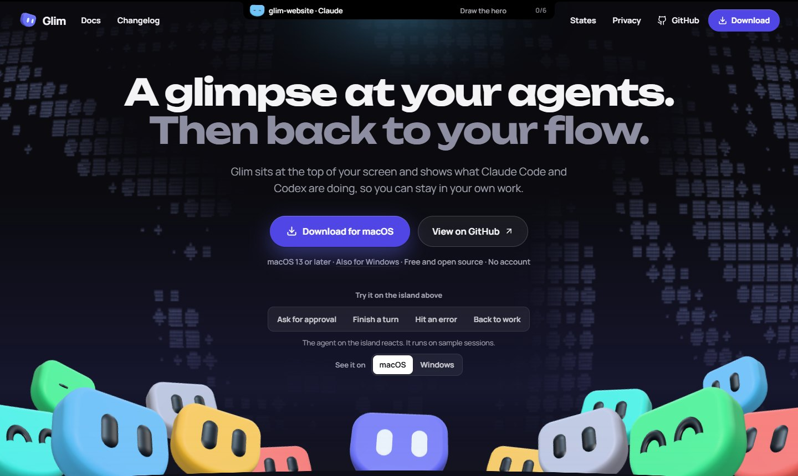

# Glim

**A glimpse at your agents. Then back to your flow.**

A minimal desktop island for Claude Code and Codex CLI, on macOS and Windows. On a MacBook it wraps the notch. Live activity, context, token usage, and reported task progress stay above your workspace. Your data stays on your device.

[](https://glim.jacobbalane.com/)

**[Try it on the website →](https://glim.jacobbalane.com/)** The page runs the real island on sample sessions. Ask for approval, finish a turn or hit an error, and watch it react. Nothing to install.

[Download for macOS or Windows](https://github.com/jacobbalane/Glim/releases/latest) · [Docs](https://glim.jacobbalane.com/docs/) · [Changelog](CHANGELOG.md) · [Compatibility](docs/compatibility.md) · [Development](docs/development.md)

> Glim is not code-signed yet. On macOS, the first time you open it, macOS says it cannot check it: click **Done**, then open **System Settings**, **Privacy & Security**, and click **Open Anyway**. On Windows, SmartScreen may warn on first run: choose **More info**, then **Run anyway**.

## What it does

- A compact island attached to the top of your selected display; on a Mac with a notch, it grows out of the notch, with nothing drawn where the camera is. Its width fits the live status, and long text scrolls into view.
- Rotating session previews, with new approvals, questions, and completions briefly taking priority. An attached banner keeps their counts visible.
- Click the preview to expand; click its header again or outside the island to collapse. The expanded view keeps your selected session stable.
- Reported token counts, cached reads, context usage, and structured task steps.
- Account limits and reset times when Claude Code supplies them.
- Local daily usage charts and 30-day retention.
- One-click, reversible connectors that preserve existing agent configuration.
- **Go to agent** brings the agent's terminal or editor to the front; on a Mac it also selects its tab in Terminal and iTerm2.
- Menu-bar or tray icon, optional start at login, fullscreen hiding, reduced motion, and keyboard navigation.
- In-app updates: **Check** in Settings finds a newer release, verifies its signature, and installs it in place.

## Getting started

1. Download Glim from the [website](https://glim.jacobbalane.com/) or [Releases](https://github.com/jacobbalane/Glim/releases/latest): `Glim_<version>_universal.dmg` for macOS 13 or later (Apple silicon and Intel), or `Glim_<version>_x64-setup.exe` for Windows 11. On a Mac, drag Glim to Applications; on Windows, run the installer.
2. Open Glim. Connect Claude Code, Codex, or both in onboarding. Glim previews the configuration entries it will add and saves backups.
3. For Codex, open `/hooks` and review and trust the Glim hooks. Glim never bypasses provider trust checks.
4. Start a new agent session as usual. No separate Glim account or API key is required.
5. Click the island for details. Use Glim's menu-bar or tray icon to open settings, pause, or quit.

Glim needs to stay running to monitor activity. Closing settings returns to the agent in the same notch; **Quit Glim** stops collection. Choose whether to keep a small idle pill or hide it until activity.

## Try the interface

To look around without building anything, open the [website](https://glim.jacobbalane.com/): it runs the same island on sample sessions. To run it locally:

```sh
npm ci
npm run dev
```

Open `http://127.0.0.1:1420`. The browser preview explicitly uses sample sessions; it does not track your computer. Add `?demo=0` to view the empty state. The installed desktop app never displays sample data.

Open **`http://127.0.0.1:1420/preview`** for all app views, including notch states, setup, settings, history, logos, and the mascot. The interactive notch lets you switch activity and views without reloading, so you can inspect transitions. Live mode renders the actual components and updates as you edit. Use Screenshots for a saved comparison, or open any view on its own.

With the development server running, capture every view:

```sh
npm run preview:capture
```

This uses installed Chrome by default (`npx playwright install chromium` and `GLIM_TEST_BROWSER=chromium` are an alternative). PNG captures stay in ignored `.cache/preview-screenshots/`, appear automatically in the gallery, and can be downloaded individually. The gallery and capture server are available only during development and are excluded from the desktop bundle.

## Build the app

Install Node.js 22.12+ (or 24+) and Rust. On Windows, use the Rust MSVC toolchain and Visual Studio C++ Build Tools with the Windows SDK; WebView2 is required for desktop development, and the installer handles it for users. On macOS 13 or later, install the Xcode Command Line Tools.

```sh
npm ci
npm run desktop
```

Create an installer for the system you are on:

```sh
npm run package
```

The Windows setup executable is in `src-tauri/target/release/bundle/nsis/`; the macOS app and disk image are in `src-tauri/target/release/bundle/macos/` and `dmg/`. See [development instructions](docs/development.md) for checks, isolated testing, and packaging.

See [architecture](docs/architecture.md) for the collection pipeline, native windows, and provider adapters.

## Privacy

Glim collects locally. It stores counters, provider/model/project names, task labels, and session state in `usage.sqlite3`, in `~/Library/Application Support/Glim` on macOS and `%LOCALAPPDATA%\Glim` on Windows. It does not store prompts, assistant messages, tool arguments, tool outputs, or provider authentication tokens. Agent transcripts are read in memory to extract usage and structured tasks. While a session is open, the island previews the agent's latest words: its last message, its question, or the command it asks to run. That preview lives in memory only and is never written to disk.

Configuration backups and connector manifests are in the same folder. Backups preserve the original agent configuration and may contain values you already saved in that configuration; treat them as private. Clearing usage history keeps ingestion cursors and deduplication baselines so old records cannot refill the chart.

There is no telemetry or cloud sync. Glim goes online only when you click **Check** under Updates in Settings, to read the latest release from GitHub. The helper sends a small allow-listed event to a local channel only the current user can open: a socket in your private temporary folder on macOS, a named pipe on Windows. On Windows, uninstalling removes Glim-owned agent hooks and the startup entry; local history is retained unless cleared in settings or you tick **Also delete my usage history** when uninstalling. On macOS, turn off each agent in Settings before moving Glim to the Trash, so Glim restores your configuration.

## Contributing

Glim's original code is MIT licensed. See [third-party notices](THIRD_PARTY_NOTICES.md) for Three.js, the bundled Manrope font and the provider marks, and [CONTRIBUTING.md](CONTRIBUTING.md) to contribute. Agent record formats evolve; sanitized adapter fixtures and compatibility reports are especially useful. Please never attach real prompts, credentials, or unredacted transcripts to issues. Report security issues privately, as described in [SECURITY.md](SECURITY.md).
