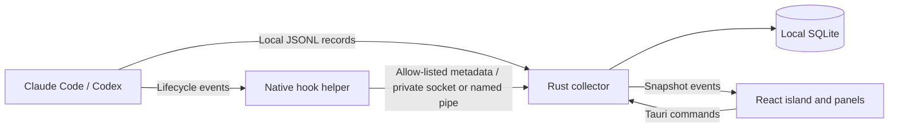

# Architecture

Glim is a local application for macOS and Windows. React renders the interface; Tauri hosts the windows and the tray or menu-bar icon; Rust collects and stores measurements. There is no application server or Glim account.

## Collection

Connectors merge user configuration only after the user chooses Connect. They retain existing hooks, back up the original configuration, and record the exact commands Glim owns. Disconnect removes those commands and restores the previous Claude status line when it is still wrapped by Glim. Codex hook trust remains the user's responsibility inside Codex.

The helper sends lifecycle metadata and optional measurements over a channel only the current user can open: a named pipe on Windows, and on macOS a socket file with mode 0600 in the per-user temporary folder, whose server also checks the connecting user. It never sends prompts or tool arguments. Failure to reach Glim succeeds silently so monitoring does not block the agent. Claude's original status-line command still receives its original input.

The collector discovers recent native session records and accepts hook-supplied transcript paths only inside the provider's directory. Parsers extract known token fields, structured task labels, model information, and supported lifecycle states. Raw records stay in memory.

Each transcript batch commits its counters, request high-water marks, cursor, and session snapshot in one SQLite transaction. Failed batches restore the live session state and can be retried. Claude streaming request snapshots use request IDs; Codex cumulative snapshots use session IDs. Optional or unsupported measurements remain unavailable in the interface.

## Windows and motion

The island is an undecorated, transparent, topmost window spanning the selected monitor's width; the visible island moves along its top edge where the person drags it (see [island dragging](island-drag.md)). On Windows it sits within the work area, and a Win32 region restricts its visible and clickable area to the island, its side panel or its quick options, measured where they come to rest so an entrance animation never leaves part of them unclickable. On macOS it floats above the menu bar on every Space, Glim stays out of the Dock, and macOS has no window regions: a 30 Hz pointer check lets clicks through wherever those same boxes are not, and the whole window keeps the pointer while the island is dragged. On a screen with a notch, the compact island spans the notch with a wing on each side, nothing drawn where the camera is, and the open island starts below it; there the island stays on the notch and is not dragged. Expanding enables focus for keyboard interaction; collapsing disables it. Background updates change measurements without expanding the island.

Settings, onboarding, history, and agent details share the same island and WebView. The tray routes navigation to that existing surface. Spring values continuously resize the visible surface and its native hit region, while content keeps its natural dimensions. Transitions can reverse immediately without replacing the window or scaling text. The tray remains available when the island is hidden or monitoring is paused.

React uses short, interruptible springs (stiffness 420, damping 40) with no bounce. Small circular shoulders join the screen edge. A notice's glow lights the whole silhouette from inside, shoulders included, through one SVG filter, so it shows even where Windows clips the window to the island; its strength is the Glow setting. The compact notch is 34 pixels tall and as wide as its text, from 144 to 360 pixels; a status longer than that scrolls after a reading pause while the project name stays still, and hover pauses it. Bottom corners grow from 17 to 24 pixels as the island expands to 440 pixels.

The notch shows one agent at a time. Working agents take turns every six seconds, with one dot each. A new approval, question, finished turn or error takes over the notch at once, holds for a few seconds, then docks in a list under the notch until it is handled; it never rotates back. Hovering, keyboard focus, expanded views and hidden documents hold both. Left alone for eight seconds, the list folds into a strip with one dot per waiting agent in its state's color; each dot glides between its row and the strip as the island changes height. Hide folds it at once, the strip unfolds it, and a newly docked notice unfolds it again. Notices Glim finds when it starts arrive folded. Folding does not acknowledge anything. Opening and closing the island acknowledges finished turns, while approvals and errors stay until the agent moves on.

The glance leads with the agent that needs attention: its plan step, context, account limits, subagents and tokens, then every other agent as one row. Official provider artwork identifies each agent. State colors are shared by the island and the character: blue working, amber needs you, teal your turn, red error, violet limit reached, green done, grey interrupted or paused. Outside clicks, focus loss and Escape collapse the island. Panels scroll inside the same surface when needed.

The Glim character is a 3D model shared with the website (`src/mascot-renderer.ts`). One WebGL context draws every visible character into its own canvas at up to 30 frames per second; hidden, off-screen and inactive characters stop drawing. Its color is the state and its eyes are the mood. Three.js loads separately from the interface, and an SVG character stands in until the first frame and wherever WebGL is unavailable or lost. Reduced motion draws one frame per state change, stops the ticker and makes the springs jump. Manrope is bundled locally, so rendering the interface requires no remote font requests.

## Extending providers

Add a provider normalization adapter and sanitized fixtures before exposing its connector. Separate lifecycle events, per-request or cumulative token measurements, current context measurements, and account limits. Support existing provider authentication rather than storing credentials in Glim. Document the provider version and its known limits in [compatibility](compatibility.md).

## Verification

Frontend unit tests check token math and session ranking. Browser tests exercise expansion, interruption, selection, setup, history filtering, reduced motion, and narrow layouts. Rust tests cover normalization, configuration preservation, replay handling, partial records, and transaction rollback. The native smoke tests exercise the real app on each system (WebView2 and the pipe on Windows, WKWebView and the socket on macOS), the real helper, isolated provider configuration, and persistence using synthetic records. On macOS, CI also installs Glim from its disk image and updates it from one version to the next through Settings.

Live authenticated provider sessions, clean-machine installation and upgrades, and signing remain release acceptance checks; synthetic integration tests do not establish those results.
