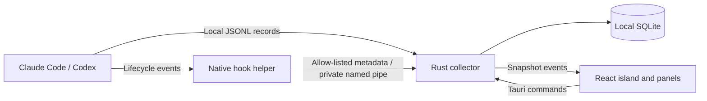

# Architecture

Glim is a local Windows application. React renders the interface; Tauri hosts the windows and tray; Rust collects and stores measurements. There is no application server or Glim account.

## Collection

Connectors merge user configuration only after the user chooses Connect. They retain existing hooks, back up the original configuration, and record the exact commands Glim owns. Disconnect removes those commands and restores the previous Claude status line when it is still wrapped by Glim. Codex hook trust remains the user's responsibility inside Codex.

The helper sends lifecycle metadata and optional measurements to a pipe restricted to the current Windows user. It never sends prompts or tool arguments. Failure to reach Glim succeeds silently so monitoring does not block the agent. Claude's original status-line command still receives its original input.

The collector discovers recent native session records and accepts hook-supplied transcript paths only inside the provider's directory. Parsers extract known token fields, structured task labels, model information, and supported lifecycle states. Raw records stay in memory.

Each transcript batch commits its counters, request high-water marks, cursor, and session snapshot in one SQLite transaction. Failed batches restore the live session state and can be retried. Claude streaming request snapshots use request IDs; Codex cumulative snapshots use session IDs. Optional or unsupported measurements remain unavailable in the interface.

## Windows and motion

The island is an undecorated, transparent, topmost window positioned within the selected monitor's work area. A Win32 region restricts its visible and clickable area to the island. Expanding enables focus for keyboard interaction; collapsing disables it. Background updates change measurements without expanding the island.

Settings, onboarding, history, and agent details share the same island and WebView. The tray routes navigation to that existing surface. Spring values continuously resize the visible surface and its native hit region, while content keeps its natural dimensions. Transitions can reverse immediately without replacing the window or scaling text. The tray remains available when the island is hidden or monitoring is paused.

React uses short, interruptible spring transitions with no bounce. Concave shoulders join the screen edge. The compact surface measures its current text and resizes between 144 and 360 pixels; longer text scrolls after a reading pause. Text updates fade upward, and working labels cycle their dots without changing width. Both headers are 42 pixels tall with the same 18-pixel inset. The expanded header is also a collapse target, while its settings and session buttons retain their own actions.

The compact preview rotates sessions every six seconds, allowing longer text enough time to scroll. Working sessions receive two slots for every other session. New approvals, questions, completions, and errors briefly take priority, then normal rotation resumes. Hovering, keyboard focus, expanded views, and hidden documents pause rotation. A continuous extension of the compact surface summarizes outstanding attention and opens the session list. Completed turns remain in this summary for ten minutes; a new turn clears that session's completion state. The expanded view keeps the selected session stable.

The expanded glance shows tokens, context, and available account limits above a larger live status and current process. Official provider artwork identifies the selected agent, with orange accents for Claude and blue for Codex. Status dots sit beside their labels, with amber for attention, green for completion, and red for errors. The notch stays black. React Bits Crystalized Ball appears beside the working status in a 72-pixel container; Star Border adds a moving accent to primary buttons. The ball renders at a maximum of 24 frames per second with a reduced particle budget, suspends when hidden or outside the viewport, and is unmounted when not working. Reduced-motion changes apply immediately: the ball and marquee become still, text crossfades, and moving button accents stop. Outside clicks and focus loss collapse every view. Panels scroll inside the same surface when needed.

The original Glim mark is a filled notch silhouette with two eyes. Its animated SVG variant appears in onboarding and empty states, follows the pointer, and responds to a click. Blinking pauses when the window is hidden, and reduced-motion preferences disable movement. Manrope is bundled locally, so rendering the interface requires no remote font requests.

## Extending providers

Add a provider normalization adapter and sanitized fixtures before exposing its connector. Separate lifecycle events, per-request or cumulative token measurements, current context measurements, and account limits. Support existing provider authentication rather than storing credentials in Glim. Document the provider version and its known limits in [compatibility](compatibility.md).

## Verification

Frontend unit tests check token math and session ranking. Browser tests exercise expansion, interruption, selection, setup, history filtering, reduced motion, and narrow layouts. Rust tests cover normalization, configuration preservation, replay handling, partial records, and transaction rollback. The native smoke test exercises WebView2, the real helper and pipe, isolated provider configuration, and persistence using synthetic records.

Live authenticated provider sessions, clean-machine installation and upgrades, and signing remain release acceptance checks; synthetic integration tests do not establish those results.
